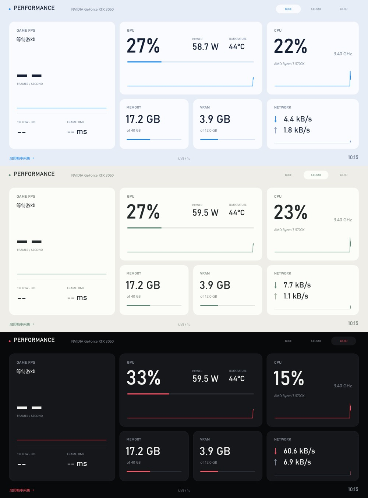
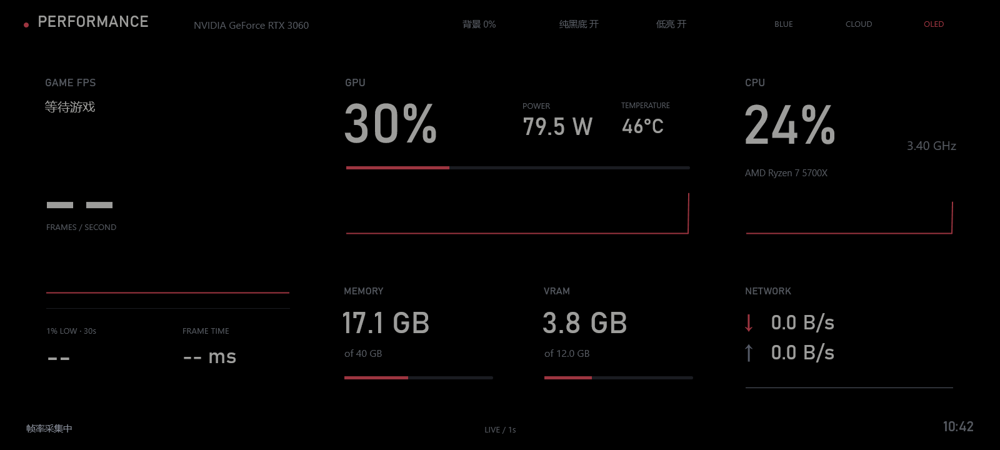

# Rainmeter Phone Monitor

为手机副屏设计的简约 **Rainmeter 皮肤套件与原生采集插件**。它依赖 Rainmeter，
不是独立监控软件。提供蓝白、暖灰绿、OLED 黑红三种配色，以及可保存的背景透明度和低亮设置。



## 功能

| 区域 | 数据来源与内容 |
| --- | --- |
| GPU | 原生 `PhoneTelemetry.dll` 通过 NVIDIA NVML 读取占用率、功耗、温度和显存 |
| CPU | Rainmeter 读取占用率、频率；插件读取 Windows 报告的处理器名称 |
| 内存、网络 | Rainmeter 内置物理内存、上传和下载速率 measure |
| 游戏帧率（实验性） | 可选 `FPSBridge.exe` 调用官方 PresentMon，计算 FPS、30 秒窗口的 1% Low 和帧时间 |
| 显示 | 背景不透明度、纯黑底、低亮开关；配色切换时保留设置 |

默认画布 **1600 × 720**，适合横屏手机。每秒更新一次；`S` 变量可用于等比缩放。
皮肤不采集 CPU 温度或 CPU 功耗，当前 GPU 采集仅支持 NVIDIA。

## 依赖

- Windows 10/11 x64，Rainmeter 4.5+ x64。
- NVIDIA 显卡及驱动（GPU 指标需要 NVML；无 NVML 时 CPU、内存和网络仍可用）。
- 开发或从源码安装：Python 3.10+、CMake 3.20+、Ninja、C++17 编译器。
- FPS 为可选功能，需单独下载约 1 MB 的官方 PresentMon 2.6.0 控制台程序。
  Windows ETW 采集通常需要管理员权限；通过皮肤按钮启动时会出现 UAC 提示。

使用 Windows 自带字体，不附带字体文件、Rainmeter、显卡驱动或大型监控软件。
本仓库只提交源码、配置、文档及预览图，不提交预编译二进制和个人桌面布局。

**副屏运行时不需要 Python。** Python 脚本仅用于开发、下载、打包和验证；
运行时只使用 Rainmeter、原生插件及可选的 FPS 采集程序。

## 构建与打包

以下命令在仓库根目录的 PowerShell 中运行，示例使用 MinGW-w64 与 Ninja：

```powershell
python tools/generate_themes.py
cmake -S . -B build -G Ninja -DCMAKE_BUILD_TYPE=Release -DCMAKE_CXX_COMPILER=g++
cmake --build build
python tools/fetch_presentmon.py
python tools/package.py --with-presentmon
```

不需要 FPS 时，跳过下载，执行 `python tools/package.py` 即可。
已有 Visual Studio 开发环境也可在 Developer PowerShell 中使用 Ninja 配合 `cl`：

```powershell
cmake -S . -B build-msvc -G Ninja -DCMAKE_BUILD_TYPE=Release -DCMAKE_CXX_COMPILER=cl
cmake --build build-msvc
python tools/package.py --build-dir build-msvc --with-presentmon
```

本机验证使用 MinGW；CI 同时检查 MinGW 与 MSVC。构建产物位于 `build/`，
安装包目录位于 `dist/`。PresentMon 下载脚本固定版本与 SHA-256，
下载后必须通过摘要校验，打包时保留上游许可证。

## 安装到 Rainmeter

1. 从 Rainmeter 管理窗口确认实际的皮肤目录，然后退出 Rainmeter。
2. 将 `dist/Skins/PhoneMonitor` 复制到自己的皮肤目录。
3. 将 `dist/Plugins/PhoneTelemetry.dll` 复制到 Rainmeter 用户插件目录。
   标准安装通常为 `%APPDATA%\Rainmeter\Plugins`；便携版为其自身 `Plugins` 目录。
4. 启动 Rainmeter，刷新全部，加载 `PhoneMonitor/Graphite.ini`（OLED）或另两种配色。
5. 将皮肤拖到手机扩展屏，定位后可在 Rainmeter 设置中关闭拖动。

也可以使用安装脚本，路径必须替换为自己的实际目录：

```powershell
.\tools\install.ps1 `
  -SkinPath "$([Environment]::GetFolderPath('MyDocuments'))\Rainmeter\Skins" `
  -PluginPath "$env:APPDATA\Rainmeter\Plugins"
```

脚本在覆盖现有皮肤前创建带时间的备份，并保留 `DisplaySettings.inc`。
它不会修改其他皮肤或停止其他采集软件。卸载时退出 Rainmeter，删除
`PhoneMonitor` 皮肤目录和本项目的 `PhoneTelemetry.dll` 即可。

## 透明度与 OLED

顶部三个控制在三种配色间共享，自动保存到 `@Resources/DisplaySettings.inc`：

| 控制 | 操作 |
| --- | --- |
| 背景 | 点击以 0/25/50/75/100% 循环；滚轮每次调 10%。数字为**不透明度**，0% 为全透明 |
| 纯黑底 | 开：透明区域显示纯黑；关：透明区域露出桌面或其他窗口 |
| 低亮 | 将主题 RGB 通道降到原来的 65%；不改变手机硬件亮度 |

默认采用 **背景 0% + 纯黑底开 + 低亮开**，OLED 用户建议加载 Graphite。
亮色配色在低不透明度的纯黑底上会自动采用浅色文字，保证可读性。



透明本身不能防烧屏；纯黑减少发光区域，固定文字仍可能导致不均匀老化。
建议同时降低手机亮度，长时间不用时熄屏。本项目没有像素偏移或屏幕保护定时器。

## FPS 采集与限制

点击左下角“启用帧率采集”，确认 Windows UAC 后，`FPSBridge` 启动 PresentMon，
使用独立 ETW 会话 `RainmeterPhoneFPS`。不会停止其他名称的采集会话。
离开全部 PhoneMonitor 配色 30 秒后，辅助程序会终止其 PresentMon 子进程并退出。

- 优先选择前台应用的交换链，否则选择最近帧事件较多的合格进程。
- 常见浏览器、桌面合成器、流媒体工具和启动器被排除；这不是自动识别游戏的保证。
- FPS 与平均帧时间使用最近约 1.5 秒的数据；1% Low 将最近 30 秒内最慢 1% 的帧时间
  取平均，再换算为 FPS。启动不足 30 秒时使用已有样本。
- 尚无真实游戏与反作弊兼容性验证结果。**FPS 功能按实验性提供**；有进程运行并不代表
  已收到游戏帧事件。未收到有效数据时显示 `--`，不会填入模拟数字。
- `fps-state.txt` 是本地临时状态文件；没有外发数据或在线遥测。

若点击按钮后仍无帧率，先确认 PresentMon 已下载、UAC 已同意，并在运行中的
DirectX 游戏里检查。某些游戏、权限隔离和反作弊方案可能限制 ETW 采集。

## 开发、lint 与检查

```powershell
uv sync --group dev
uv run ruff check .
uv run ruff format --check .
uv run python tools/check.py
uv run python -m unittest discover -s tests -v
python tools/smoke_telemetry.py --dll build/PhoneTelemetry.dll
```

`tools/check.py` 检查 C++ clang-format、Lua 语法、PowerShell 语法、Rainmeter 配置及生成结果。
C++ 编译启用警告即错误；格式化用 `clang-format -i src/*.cpp tests/*.cpp`。
可选的短时 Direct3D 验证程序需通过
`-DPHONE_MONITOR_BUILD_PROBE=ON` 构建，它只用于采集链路调试。

```text
src/                         C++ 原生 GPU 插件与 FPS 桥接程序
skins/PhoneMonitor/          三种 Rainmeter 配色及 Lua 显示控制
tools/                       生成、下载、打包、安装与检查脚本
tests/                       配置与采集协议检查、可选 Direct3D 调试程序
docs/images/                 界面预览
.github/workflows/           GitHub CI
.gitlab-ci.yml               GitLab CI
```

生成的 `.ini` 与 `.inc` 使用带 BOM 的 UTF-16，Python、C++ 和 Lua 源码使用 UTF-8。
详见 [CONTRIBUTING.md](CONTRIBUTING.md)。

## 许可证

本项目代码使用 [MIT License](LICENSE)。PresentMon、Rainmeter、NVML 和 Windows 字体
保留各自许可证，参见 [THIRD_PARTY_NOTICES.md](THIRD_PARTY_NOTICES.md)。
